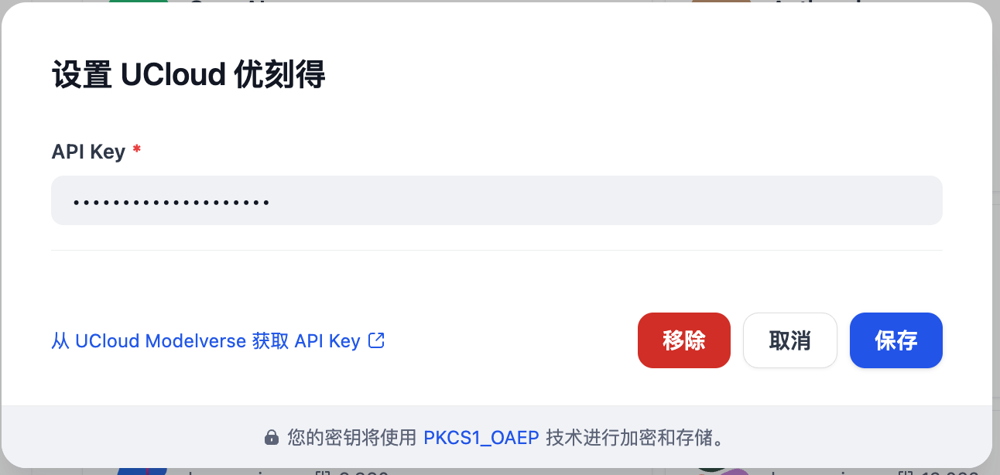

# UCloud ModelVerse

UCloud ModelVerse provides access to supported language and embedding models
through an OpenAI-compatible API. This plugin integrates those models with Dify
for chat, agent tool calling, vision input, and text embeddings.

## Setup

1. Create an API key in the
   [UCloud ModelVerse console](https://astraflow.ucloud.cn/modelverse/api-keys).
2. In Dify, open **Settings → Model Provider → UCloud**.
3. Enter the API key and save the provider configuration.
4. Select a UCloud model when configuring an application or agent.

## Usage

Use the provider like any other Dify model provider. Agent function calling uses
the current `tools` and `tool_calls` protocol, including streamed and parallel
tool calls. The `auto` model delegates model selection to ModelVerse.

## Connection requirements

The Dify plugin runtime must allow outbound HTTPS access to
`api.modelverse.cn`. User prompts, model inputs, and optional image URLs are sent
to this endpoint for inference. No inbound network access is required.

## Source and privacy

- Source repository: https://github.com/ucloud/dify-plugin
- Privacy policy: [PRIVACY.md](PRIVACY.md)

